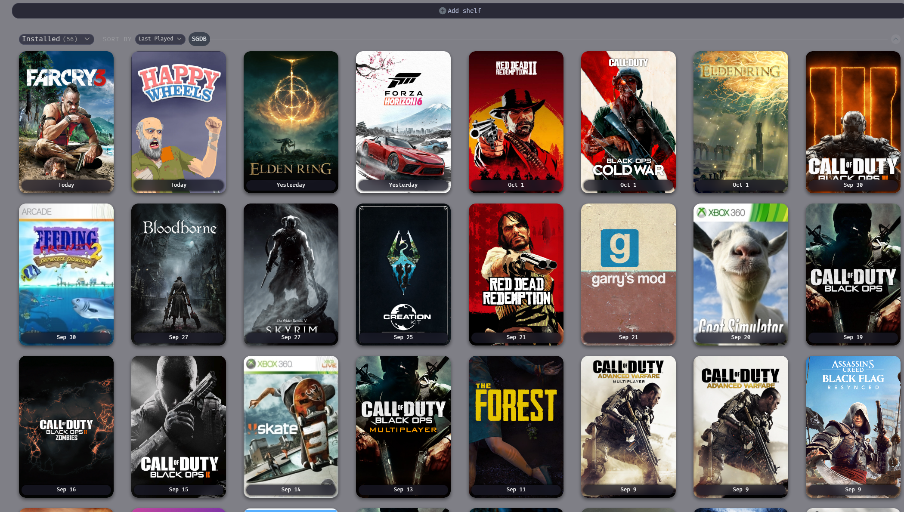

<div align="center">



# Mocha Steam for Millennium

**A Catppuccin Mocha theme for the Steam client on [Millennium](https://steambrew.app), with native Windows acrylic.**

The theme, a patched DWMX acrylic plugin, and a setup script that installs my whole Millennium setup.

<a href="https://github.com/DavidHiFi/millennium-stuff/releases/latest">

</a>

<br><br>


</div>

---

## Installation

### Theme and acrylic plugin

1. [Download the latest release](https://github.com/DavidHiFi/millennium-stuff/releases/latest) and extract it.
2. Exit Steam.
3. In the extracted folder, run:

   ```powershell
   powershell -NoProfile -ExecutionPolicy Bypass -File .\install.ps1 -Apply -Configure
   ```

4. Start Steam. Mocha Steam is selected and DWMX is on.

Without `-Apply`, `install.ps1` only shows what it would do. Add `-SteamPath 'D:\Steam'` if Steam lives somewhere else.

### The whole setup

This installs Millennium if it is missing, the theme, DWMX, 23 plugins and my plugin settings. Run it in Windows PowerShell:

```powershell
irm https://raw.githubusercontent.com/DavidHiFi/millennium-stuff/main/setup/Install-MochaSetup.ps1 | iex
```

1. If Millennium is missing, the official Millennium installer opens. Click through it.
2. The script closes Steam, installs everything and merges your Millennium config after backing it up.
3. Start Steam when it finishes.

To read the plan before anything changes, download the script and run it in audit mode:

```powershell
Invoke-WebRequest https://raw.githubusercontent.com/DavidHiFi/millennium-stuff/main/setup/Install-MochaSetup.ps1 -OutFile Install-MochaSetup.ps1
powershell -NoProfile -ExecutionPolicy Bypass -File .\Install-MochaSetup.ps1 -Audit
```

Add `-SteamPath 'D:\Steam'` for a Steam folder elsewhere, or `-SkipMillenniumInstall` to stop the script from starting the Millennium installer.

## Features

### Theme

- **Catppuccin Mocha:** the Mocha palette with Blue and Lavender accents, across Library, Store, settings, friends and chat.
- **Rounded controls:** rounded cards, menus, dropdowns and buttons that keep their corners.
- **Frosted menus:** menus, tooltips, dropdowns and dialogs blur what sits behind them.
- **Native acrylic:** Windows 11 acrylic behind Steam's separate popup windows, through DWMX.
- **Tidy library:** game icons and ProtonDB indicators line up in one column.
- **Library frame:** the sidebar, the Downloads bar and the user panel sit inside one frame below the top bar.
- **SpaceTheme options:** sidebar behavior, fonts, window controls, gift-card visibility and favorite-friend status colors.

### Setup script

- **Plugins:** installs 23 plugins at the versions pinned in [setup/manifest.json](setup/manifest.json).
- **Settings:** writes my Millennium config and plugin settings, merged into yours.
- **Safe re-runs:** backs up your config and keeps plugin data such as the Gratitude friend list.

## Notes

> [!IMPORTANT]
> **Acrylic needs Windows 11 and Windows transparency effects turned on.** Also turn on **Mica & Acrylic plugin support** in the theme options. Without them, Mocha Steam is a plain dark theme.

> [!NOTE]
> **Fonts are not included.** The default font is Be Vietnam Pro. Install it, or pick a font you have in the theme options.

> [!WARNING]
> **Steam updates can break parts of the theme.** Selectors and popup behavior change between Steam versions. [Open an issue](https://github.com/DavidHiFi/millennium-stuff/issues/new) with a screenshot when something looks wrong.

<details>
<summary><b>Four plugins to install by hand</b></summary>

<br>

These plugins publish no license, so this repo does not include their code. Install each one from Millennium's plugin store, or from its repository at the commit below. Millennium enables them once they are in place, because the config already lists them.

| Plugin | Repository | Commit |
| --- | --- | --- |
| `adamraichu.auto-accept-custom-launch-args` | [AdamRaichu/auto-accept-custom-launch-args](https://github.com/AdamRaichu/auto-accept-custom-launch-args) | `084d32b` |
| `browser_history` | [ricewind012/steam-browser-history](https://github.com/ricewind012/steam-browser-history) | `8214f36` |
| `easy-restart-reload-for-steam` | [SaiyajinK/Easy-Restart-Reload-for-Steam](https://github.com/SaiyajinK/Easy-Restart-Reload-for-Steam) | `dc79ae2` |
| `steam-change-window-params` | [ricewind012/steam-change-window-params](https://github.com/ricewind012/steam-change-window-params) | `ee57e92` |

The auto-accept plugin turns off a Steam safety prompt for custom launch arguments. Read its README before you install it.

</details>

<details>
<summary><b>What the setup script does not copy</b></summary>

<br>

- **Lua Tools Collection:** my plugin for SteamTools Lua scripts lives in [luatools-collection](https://github.com/DavidHiFi/luatools-collection) and is not installed.
- **Personal data:** Steam friend lists, Gratitude data, non-Steam playtime sessions, the list of installed Windows apps and proxy settings stay on my PC.
- **Steam's own state:** your account, library and window positions are not part of the setup.

Every plugin with its source and version is listed in [NOTICE.md](NOTICE.md).

</details>

<details>
<summary><b>Repo layout and building DWMX</b></summary>

<br>

| Path | What it is |
| --- | --- |
| `themes/mocha-steam/` | The theme. The [MochaSteam repo](https://github.com/DavidHiFi/MochaSteam) holds the same files with `skin.json` at its root for Millennium's theme installer. |
| `plugins/dwmx/` | The built DWMX plugin that the installers copy. |
| `plugins/dwmx-src/` | The patched DWMX source. |
| `setup/` | The full-setup script, its plugin manifest, config templates and vendored MIT plugins. |
| `configs/` | An example Millennium config and the SpaceTheme commit the theme is synced to. |
| `docs/` | Notes on the theme and on the DWMX acrylic patch. |

Build DWMX from `plugins/dwmx-src` with [pnpm](https://pnpm.io):

```powershell
pnpm install
pnpm build
```

</details>

## Contributing

Reports of Steam updates that break the theme help the most, with a screenshot, along with fixes to the setup script and the plugin manifest.

<a href="CONTRIBUTING.md">

</a>

## Star history

Thanks for the stars, the Steam client reports and the plugin fixes.

<a href="https://www.star-history.com/?repos=DavidHiFi%2Fmillennium-stuff&amp;type=date">
  <picture>
    <source media="(prefers-color-scheme: dark)" srcset="https://api.star-history.com/chart?repos=DavidHiFi/millennium-stuff&amp;type=date&amp;theme=dark&amp;legend=top-left" />
    <source media="(prefers-color-scheme: light)" srcset="https://api.star-history.com/chart?repos=DavidHiFi/millennium-stuff&amp;type=date" />
    
  </picture>
</a>

## Credits

- **Author:** Myself, [DavidHiFi](https://github.com/DavidHiFi)

| Who | What |
| --- | --- |
| **SpaceEnergy** ([SpaceTheme for Steam](https://github.com/SpaceTheme/Steam)) | Mocha Steam is a fork of SpaceTheme (MIT), synced through commit `ce67165`, including ForgottenHero's hover-sidebar fix and EldinBegano's dropdown styling. |
| **ejalxndr** ([DWMX](https://github.com/ejalxndr/dwmx)) | The Window Styler (DWMX) plugin (Apache-2.0) that I patched for popup acrylic. |
| **Catppuccin** ([catppuccin](https://github.com/catppuccin/catppuccin)) | The Mocha color values. |
| **Microsoft** ([Fluent UI System Icons](https://github.com/microsoft/fluentui-system-icons)) | The icon font that SpaceTheme ships (MIT). |
| **luthor112** ([GitHub](https://github.com/luthor112)) | Steam Collections Plus, Steam EasyGrid, Steam Librarian and Steam Taskbar Progress, included in `setup/vendor/` (MIT). |
| **SalvadorCorreia** ([Sortium](https://github.com/SalvadorCorreia/Sortium)) | Sortium, included in `setup/vendor/` (MIT). |
| **veygax** ([valve-internal-enabler](https://github.com/veygax/valve-internal-enabler)) | Included in `setup/vendor/` (MIT). |
| **xwxfox** ([millennium-uwp-library-sync](https://github.com/xwxfox/millennium-uwp-library-sync)) | UWP Library Sync, included in `setup/vendor/` (MIT). |
| **Plugin authors** ([full list](NOTICE.md)) | The 16 plugins the setup script downloads from their own releases, and the four installed by hand. |
| **Steam Client Homebrew** ([PluginDatabase](https://github.com/SteamClientHomebrew/PluginDatabase)) | The approved repositories and commits the plugin manifest is pinned to. |

Built on [Millennium](https://github.com/SteamClientHomebrew/Millennium), with [PowerShell](https://github.com/PowerShell/PowerShell) for the installers and [pnpm](https://pnpm.io) with [@steambrew/ttc](https://www.npmjs.com/package/@steambrew/ttc) for the DWMX build.

> Missing or wrong credit? [Open an issue](https://github.com/DavidHiFi/millennium-stuff/issues/new) and I'll fix it.

## Disclaimers

Most of this project's code was developed with AI coding agents, including Claude and OpenCode. No single AI agent made the project. The theme started as SpaceEnergy's SpaceTheme, and the plugins belong to their authors.

My changes are MIT, see [LICENSE](LICENSE). SpaceTheme keeps its MIT license in `themes/mocha-steam/`, DWMX keeps Apache-2.0 in `plugins/dwmx-src/`, and every plugin keeps its own license.

<div align="center">
<br>
<sub>Not affiliated with Valve or Steam Client Homebrew. Requires Steam on Windows and <a href="https://steambrew.app">Millennium</a>.</sub>
</div>
